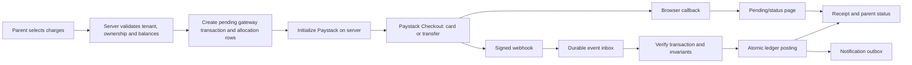

# DigiSchool-Pro Paystack Professional Recommendation

**Status:** Implementation recommendation  
**Research verified:** 24 September 2026  
**Applies to:** DigiSchool-Pro multi-school finance system  
**Primary sources:** Paystack API documentation and PaystackOSS repositories

## 0. Start here and current status

This is the controlling Paystack implementation document. The documents have the following
roles:

- [payments-and-sms-plan.md](./payments-and-sms-plan.md) — product decisions and combined rollout.
- [paystack-integration.md](./paystack-integration.md) — endpoint fields, provider behaviour, and engineering traps.
- This document — approved architecture, work order, and acceptance gates.

Current status:

- [x] Official Paystack API and PaystackOSS research completed.
- [x] Architecture and phased implementation recommendation documented.
- [x] Existing finance integration point identified.
- [x] Slice 0 readiness audited in [paystack-slice-0-readiness.md](./paystack-slice-0-readiness.md).
- [x] Canonical deployment origin and flexible school-account direction confirmed.
- [x] Conditional Slice 0 pass granted for credential-free test-mode engineering.
- [ ] Exposed test secret rotated and stored only in the environment.
- [ ] Paystack inquiry and live commercial/account gate completed.
- [x] Slice 1 code and database foundation completed; see [paystack-slice-1-completion.md](./paystack-slice-1-completion.md).
- [x] Slice 1 migration applied to local Docker MySQL.
- [x] Slice 2 server-only adapter completed; see [paystack-slice-2-completion.md](./paystack-slice-2-completion.md).
- [ ] Existing accumulated-fund reconciliation mismatch investigated separately.

No production implementation should be described as started until the unchecked Slice 0
decisions have an owner and recorded answer. Test-mode engineering may begin on Slice 1 in
parallel, provided no unsettled commercial assumption is hard-coded.

## 1. Executive decision

DigiSchool-Pro should use a **platform-managed Paystack integration with one Paystack subaccount per school** as the default operating model.

- DigiSchool-Pro owns and protects one test integration and one live integration.
- Each school completes payment onboarding in **Settings > Payments**.
- DigiSchool-Pro creates or connects that school's Paystack subaccount and stores its `subaccount_code`.
- Parents pay through Paystack Checkout using card or `bank_transfer` first.
- Paystack confirms payment through one platform webhook.
- Every confirmed gateway payment is posted into the existing `Payment`, `PaymentAllocation`, `StudentCharge`, receipt, and audit systems.
- Dedicated Virtual Accounts (DVA) should be a later, separately approved project—not part of the first checkout release.

This model gives schools a simple setup experience, centralizes security and support, and preserves tenant isolation. A school-owned-key option can be added later for large schools that contract directly with Paystack, but supporting two credential models during the first release would add unnecessary operational and security risk.

## 2. What the official Paystack material confirms

| Area | Confirmed behaviour | DigiSchool-Pro decision |
|---|---|---|
| Transaction initialization | Must be performed on the server; amount is sent in the currency subunit | Initialize only from a server action/API after validating charges and balances |
| Payment completion | Callback is not reliable proof of payment | Only the idempotent confirmation processor may post to the finance ledger |
| Webhook authentication | `x-paystack-signature` is an HMAC-SHA512 digest of the raw request body using the secret key | Verify raw bytes before parsing or storing the event |
| Webhook delivery | Events are retried and duplicates are possible | Store an inbox event and make all processing idempotent |
| Split payments | A transaction can include a school subaccount and platform charge | Use the school `subaccount_code`; configure commission explicitly |
| Fee bearer | `bearer` only chooses platform account versus subaccount | Gross up the requested amount ourselves if a school chooses “parent pays fee” |
| Amount fields | `requested_amount` is the merchant-requested amount; `amount` may include passed-on fees | Compare expected amount with `requested_amount`; validate fees separately |
| Transaction identifiers | Provider transaction IDs may exceed JavaScript-safe integer assumptions | Persist provider IDs as strings or database `BIGINT`, never a 32-bit integer |
| Refunds | Refunds have an asynchronous lifecycle and webhook events | Do not reverse the local ledger until the refund is confirmed processed |
| Disputes | Events use names such as `charge.dispute.create` | Implement the exact documented event names, not `dispute.*` |
| Pay with Transfer | Checkout can create a temporary transfer account per transaction | Offer transfer-paying parents in the checkout release |
| Dedicated accounts | DVA requires additional eligibility, customer, validation, allocation, and reconciliation logic | Pilot only after ordinary checkout and reconciliation are stable |
| Webhook recovery | The Webhook Events API can list, inspect, and resend events | Build an operations recovery screen or script around it after core checkout |

## 3. Scope of the first production release

### Include

- Test and live Paystack configuration.
- Per-school payment enablement and subaccount configuration.
- Card and Pay with Transfer checkout.
- Full-balance and policy-controlled partial payments.
- Signed webhook reception and durable event storage.
- Idempotent creation of existing finance ledger records.
- Parent payment status and receipt experience.
- Finance transaction search, failure visibility, and manual reconciliation.
- Refund lifecycle support before refunds are offered in the UI.
- Audit logging, permissions, alerts, and recovery procedures.

### Exclude initially

- Dedicated Virtual Accounts.
- Reusable card authorizations or recurring debit.
- Paystack Transfers/payout initiation.
- Subscriptions and payment pages.
- Terminal or in-person hardware.
- Automatic dispute accounting without a reviewed school policy.
- School-owned API keys.

These items are valid future capabilities, but none is required to make school-fee checkout reliable.

## 4. Recommended account and tenancy model

### Default: `PLATFORM_MANAGED`

The platform secret key remains in server environment variables. It is never placed in a browser bundle, school record, log, screenshot, or Git repository. Each school record stores only its Paystack subaccount identity and safe configuration metadata.

Recommended per-school lifecycle:

`NOT_CONFIGURED -> DETAILS_PENDING -> TEST_READY -> TEST_VERIFIED -> LIVE_PENDING -> LIVE_READY -> SUSPENDED`

A school must not receive a public “Pay now” button until it is `LIVE_READY` in the live environment.

### Future: `SCHOOL_OWNED`

Only introduce this mode when a commercial or regulatory requirement exists. It would require encrypted secret storage, rotation, separate webhook routing/signature verification, connection health checks, and school-specific support procedures. Do not add dormant plaintext key fields now.

### Important commercial confirmation

Before coding the live settlement model, obtain written confirmation from Paystack that DigiSchool-Pro's intended multi-school arrangement is supported, including:

- platform merchant and school subaccount responsibilities;
- onboarding/KYC requirements for each school;
- settlement account ownership and verification;
- permitted platform commission model;
- who may bear Paystack fees;
- refund and dispute liability;
- settlement timing and reserves;
- DVA eligibility and the account-count limit for the later pilot.

## 5. Fit with the existing finance system

DigiSchool-Pro already has the accounting destination: `StudentCharge`, `Payment`, `PaymentAllocation`, receipts, refunds/reversals, and audit controls. Paystack must be an **input channel into that ledger**, not a second finance system.

| Existing capability | Reuse | Gap to add |
|---|---|---|
| Student charges and balances | Source of truth for what may be paid | Server-side checkout selection and revalidation |
| `PaymentMethod.ONLINE` | Identifies the payment channel | Provider, channel, reference, and transaction status details |
| `Payment` | Confirmed financial receipt | Unique link to the gateway transaction |
| `PaymentAllocation` | Allocation to one or more charges | Pending allocation intent before payment succeeds |
| Receipts | Final parent evidence | Pending/failed checkout screens must not look like receipts |
| Refund/reversal controls | Accounting correction foundation | Asynchronous Paystack refund state machine |
| Audit log | Administrative accountability | Gateway configuration, replay, refund, and reconciliation events |

The existing manual payment workflow should be extracted into one internal ledger-posting service. Both manual entry and Paystack confirmation should call that service so balance, allocation, receipt, and audit rules cannot drift.

## 6. Provider boundary

Do not spread Paystack HTTP calls through pages and actions. Put them behind a small server-only provider interface.

Suggested files:

```text
lib/payments/contracts.ts
lib/payments/money.ts
lib/payments/paystack.server.ts
lib/payments/gateway-transaction.server.ts
lib/payments/process-gateway-event.server.ts
app/api/webhooks/paystack/route.ts
app/actions/payment-gateway.ts
```

Minimum provider operations:

```text
initializeTransaction
verifyTransaction
createSubaccount
updateSubaccount
listBanks
resolveBankAccount
createRefund
fetchRefund
listSettlements
listSettlementTransactions
```

### SDK recommendation

Use a small typed wrapper around native server-side `fetch` for the first release. The required endpoint set is small, and explicit parsing makes Paystack's mixed HTTP/business-status behaviour easier to control. The official `@paystack/paystack-sdk` is acceptable **inside the adapter** later, but business logic must never depend directly on its generated types.

Use the PaystackOSS OpenAPI document as a contract reference and for test fixtures. Do not assume generated code replaces runtime validation: the public documentation, test-mode responses, and observed webhook payloads remain the final integration evidence when official sources differ.

## 7. Recommended data model

Names may be adapted to the current Prisma conventions, but the responsibilities should remain separate.

### `SchoolPaymentConfiguration`

- `id`
- `schoolId` — unique
- `provider` — initially `PAYSTACK`
- `accountMode` — initially `PLATFORM_MANAGED`
- `status`
- `subaccountCode`
- `businessName`
- masked settlement bank name/account suffix
- `feePolicy` — `SCHOOL_PAYS`, `PLATFORM_PAYS`, or `PARENT_PAYS_GROSS_UP`
- `platformChargeType` and `platformChargeValue`
- enabled channels
- partial-payment policy
- allocation policy
- `configuredBy`, `configuredAt`, `verifiedAt`, `suspendedAt`

Do not store the platform secret key in this table.

### `GatewayTransaction`

- internal UUID
- `schoolId` and payer/student context
- provider and environment/domain
- internal reference and Paystack reference
- provider transaction ID stored as a string
- expected amount, requested amount, charged amount, provider fee, currency
- channel
- state: `CREATED`, `INITIALIZED`, `INITIALIZATION_UNKNOWN`, `PENDING`, `PROCESSING`, `SUCCEEDED`, `FAILED`, `ABANDONED`, `REQUIRES_REVIEW`, `REFUNDED`, or `DISPUTED`
- linked `Payment` ID after successful posting
- initialization/verification timestamps
- sanitized provider response metadata and failure details

Required uniqueness:

- `(provider, reference)`
- one confirmed `Payment` per gateway transaction

### `GatewayTransactionAllocation`

Store intended allocations as rows, not only as JSON:

- `gatewayTransactionId`
- `studentChargeId`
- intended amount
- display order if required

This preserves relational integrity and allows the server to recheck every charge before initialization and before final posting.

### `GatewayEvent`

This is the durable webhook inbox:

- provider
- event type
- transaction reference when present
- payload hash/deduplication key
- sanitized payload or encrypted/raw retention according to policy
- received, processed, and failed timestamps
- processing status and attempt count
- last error safe for operations display

Do not rely on event deduplication alone. The unique transaction reference and one-payment constraint are the final financial safeguards.

### Unapplied money/suspense responsibility

The design must represent confirmed money that cannot safely be allocated—for example, a
charge was paid by another channel after checkout began, a configuration changed, or the
provider returned an unexpected split. Use a review/suspense record or an equivalent
unapplied-credit mechanism. Never over-allocate a charge, silently discard the event, or
turn confirmed money into a generic failure.

### Later operational tables

- `GatewayRefund` for asynchronous refund status.
- `GatewaySettlement` and settlement-line matches for reconciliation.
- `GatewayDispute` for evidence, deadlines, resolution, and accounting action.

## 8. End-to-end payment flow



### Step-by-step rules

1. The parent selects eligible unpaid charges.
2. The server verifies the signed-in parent relationship, school tenant, current charge balances, part-payment policy, and total.
3. The server creates a unique reference plus pending transaction/allocation records before calling Paystack.
4. The server initializes Paystack with the correct amount in kobo, email, allowed channels, callback URL, school subaccount, platform charge, and minimal metadata.
5. The browser is redirected only to the returned Paystack authorization URL.
6. The browser callback displays status; it does not create a `Payment` or mark a charge paid.
7. The webhook route verifies the signature over the unmodified raw body, records the event durably, and responds quickly with HTTP 200.
8. The idempotent processor calls the verify endpoint and validates every invariant.
9. One short database transaction creates `Payment`, creates `PaymentAllocation` rows, updates the gateway state, and writes an audit entry.
10. Receipt generation and SMS/email are queued after the financial transaction commits.

If initialization times out, retain the same reference in `INITIALIZATION_UNKNOWN` and
verify it before allowing a replacement attempt. If local balances change before a valid
confirmation, place the received money in `REQUIRES_REVIEW`/suspense for controlled
allocation. Disabling a school prevents new checkouts but does not invalidate money already
received for an earlier checkout.

For shared-hosting/cPanel deployments, the durable inbox is essential. A cron processor can recover events even if the web process exits after accepting a webhook. The callback status page may safely request verification to improve perceived speed, but it must call the same idempotent confirmation service.

## 9. Payment confirmation invariants

No ledger entry is allowed unless all relevant checks pass:

- Paystack response top-level status is successful.
- `data.status` is exactly the accepted successful status.
- provider reference equals the locally generated reference.
- environment/domain is the expected test or live environment.
- currency is the configured school currency.
- `requested_amount` equals the locally expected amount in kobo.
- `amount - requested_amount` agrees with provider fee/gross-up expectations when applicable.
- school/tenant comes from the local transaction, not untrusted metadata.
- subaccount/split result agrees with the school configuration when returned.
- all selected charges still belong to the same student/school and are eligible.
- total allocations equal the requested school-fee amount.
- no `Payment` is already linked to the transaction.
- the saved transaction configuration snapshot, not today's mutable school setting, is used.

Paystack may return HTTP 200 while the business operation failed. Always evaluate the response body, not HTTP status alone.

## 10. Money, fee, and commission rules

- Convert internal decimal-naira amounts to integer kobo in one tested function.
- Reject non-positive amounts and any value that cannot round exactly according to the system's currency rules.
- Never calculate money with JavaScript floating-point arithmetic.
- Store the expected school-fee amount separately from the total charged to the parent.
- `bearer` does not make the parent pay. It assigns fees between the platform and subaccount.
- If the parent pays the fee, DigiSchool-Pro must gross up the charge and disclose the exact fee before confirmation.
- Platform commission and Paystack processing fee are different concepts and require separate fields and reports.
- Metadata is descriptive only; it is not authorization and is not the source of tenant identity.
- Checkout requires a valid payer email; placeholder addresses must not merge unrelated families.

Changing a fee policy after a transaction is initialized must not alter that transaction. Snapshot the effective configuration on each `GatewayTransaction`.

## 11. Webhook security and reliability

The webhook endpoint should implement these controls:

1. Read the raw request body once.
2. Compute HMAC-SHA512 using the correct environment secret.
3. Compare signatures with a timing-safe comparison.
4. Reject missing or invalid signatures without processing.
5. Parse JSON only after signature verification.
6. Store the event/inbox record before acknowledging it.
7. Return HTTP 200 promptly; do not send SMS, render PDFs, or perform other slow work in the request.
8. Make processing safe to repeat after a retry, replay, callback verification, or manual recovery.
9. Redact authorization data, account details, email, phone, and secrets from application logs.
10. Monitor unprocessed/failed inbox events and alert finance/support.
11. Apply a documented retention/redaction policy to webhook payloads containing personal or financial data.
12. Use a unique notification-outbox key so webhook retries cannot send multiple receipts or SMS messages.

Paystack's documented source IP addresses may be used as a second control, but never as a replacement for the signature. IP allowlisting should only be enabled where the deployment has stable networking and an operational process for Paystack address changes.

The Webhook Events API should be used for recovery. Because resending is itself not idempotent, the DigiSchool-Pro handler must remain safe under repeated replays.

## 12. Refunds, disputes, and settlements

### Refunds

Use an explicit state machine:

`REQUESTED -> PENDING/PROCESSING -> PROCESSED` or `FAILED`

- Confirm staff permission and refundable balance.
- Record the request before calling Paystack.
- Reuse an idempotency/reference strategy for retries.
- Do not delete the original payment or receipt.
- Apply the accounting reversal exactly once after confirmed processing.
- Generate a credit/refund record linked to the original payment.

### Disputes

Handle documented `charge.dispute.*` events. A dispute should flag and lock the relevant payment for finance review, preserve the original audit trail, record deadlines/evidence, and apply the school's approved accounting policy only after resolution.

### Settlements

Payment success and bank settlement are not the same event. Reconciliation should compare:

- local confirmed gateway transactions;
- Paystack transaction records;
- settlement transactions;
- expected subaccount/platform amounts;
- fees, refunds, and disputes.

Surface unmatched, underpaid, overpaid, duplicated, refunded, disputed, and unsettled items. Never silently edit the ledger to force a match.

## 13. User experience recommendation

### School administrator: Settings > Payments

Use a guided setup rather than exposing raw provider fields:

1. Explain settlement, fees, and required documents.
2. Capture legal business and settlement account details.
3. Resolve and display the account name before submission.
4. Create/update the subaccount on the server.
5. Show masked bank details and connection status.
6. Configure channels, partial payments, fee policy, and platform charge where authorized.
7. Run a test transaction checklist.
8. Require an authorized user to enable live payments.

Every sensitive change should require an explicit confirmation, permission check, and audit event.

### Parent checkout

- Show the learner, charge lines, school-fee subtotal, processing fee if passed on, and final amount.
- Prevent selection of charges from different schools in one transaction.
- Clearly explain card versus bank transfer.
- After returning from Paystack, show `Confirming payment` until the local transaction succeeds.
- Provide a retry path that creates a new reference without duplicating a successful payment.
- Show a receipt only after local confirmation.

### Finance operations

Provide searchable views for:

- pending, successful, failed, abandoned, refunded, and disputed transactions;
- webhook events needing attention;
- unmatched gateway/ledger records;
- settlement reconciliation;
- refund status and dispute deadlines;
- safe event retry/reconciliation actions with audit history.

## 14. Permissions and audit events

Add or map least-privilege permissions for:

- payment gateway configuration;
- test/live activation;
- transaction viewing;
- reconciliation;
- refund request and refund approval;
- dispute management;
- webhook replay/reprocessing.

Audit at minimum:

- configuration and fee-policy changes;
- subaccount creation/update/suspension;
- live enable/disable;
- checkout initialization;
- successful or rejected confirmation;
- manual event replay/reprocessing;
- refund request/approval/result;
- dispute and settlement actions.

Never place secret keys or complete sensitive provider payloads in the audit description.

## 15. Implementation sequence and acceptance gates

Implement one slice at a time. Do not begin the next slice until its gate passes.

### Slice 0 — Provider and business confirmation

Deliverables:

- Enable Paystack account 2FA.
- Complete business activation/KYC planning.
- Obtain written answers to the commercial questions in Section 4.
- Confirm test/live domain and callback/webhook URLs.
- Store test secrets only in the deployment secret environment.

**Gate:** The team can state who owns the merchant relationship, each settlement account, fees, refunds, disputes, and platform commission.

### Slice 1 — Internal contract and schema

Deliverables:

- Add provider/domain enums and the four core records described in Section 7.
- Add unique constraints and foreign keys.
- Extract one idempotent internal ledger-posting service.
- Add migration and data-integrity tests.

**Gate:** A simulated confirmed transaction can create exactly one balanced payment and allocations without contacting Paystack.

### Slice 2 — Paystack server adapter

Deliverables:

- Environment validation.
- Typed request/response parsing.
- Initialize, verify, bank list/resolve, and subaccount operations.
- Timeout, rate-limit, safe retry, and redacted error handling.
- Contract tests using captured/sanitized test responses.

**Gate:** Automated tests reject HTTP-200 business failures, invalid shapes, wrong amounts, and wrong environments.

### Slice 3 — School payment onboarding

**Implementation status (25 September 2026): complete locally.** See
`documentation/paystack-slice-3-completion.md` for the implemented account modes, security
controls, migration, and verification evidence. Real provider-side verification remains
blocked until the disclosed test secret is rotated.

Deliverables:

- Payment settings wizard.
- Bank/account resolution.
- Subaccount creation/update.
- Masked status summary and audit history.
- Permission and live-readiness checks.
- Required payer-contact readiness and a clear remediation path for missing email.

**Gate:** Two test schools can be configured independently without seeing or changing each other's records.

### Slice 4 — Checkout initialization

**Implementation status (25 September 2026): complete locally.** See
`documentation/paystack-slice-4-completion.md` for authorization, immutable allocation,
duplicate-attempt, uncertain-initialization, amount-validation, and UX evidence.

Deliverables:

- Parent charge selection and balance revalidation.
- Pending transaction/allocation creation.
- Server-side Paystack initialization.
- Paystack redirect and pending/status page.
- Retry/abandon behaviour.

**Gate:** Test checkouts initialize only for authorized charges, exact totals, valid school configuration, and unique references.

### Slice 5 — Webhook inbox and ledger confirmation

**Implementation status (25 September 2026): complete locally.** See
`documentation/paystack-slice-5-completion.md` for signature verification, minimized durable
inbox storage, atomic ledger posting, duplicate-event proof, and cPanel recovery setup.

Deliverables:

- Raw-body signature verification.
- Durable event inbox.
- Idempotent verify-and-post processor.
- Fast HTTP acknowledgement and cPanel cron recovery.
- Callback status polling through the same transaction state.

**Gate:** Sending the same success event repeatedly creates one payment, one set of allocations, one receipt, and one notification request.

### Slice 6 — Parent and finance experience

**Implementation status (26 September 2026): complete locally.** See
`documentation/paystack-slice-6-completion.md` for the school-scoped transaction register,
event diagnostics, controlled recovery, parent status experience and verification evidence.

Deliverables:

- Clear success, pending, failed, and abandoned states.
- Confirmed receipt access.
- Finance gateway transaction list and detail.
- Failed-event diagnostics and safe reprocessing.
- Accessibility and mobile tests.

**Gate:** A parent can complete or safely retry payment, and finance can explain every gateway state without database access.

### Slice 7 — Refunds, disputes, and reconciliation

Deliverables:

- Refund state machine and approval flow.
- Dispute event handling and evidence workflow.
- Daily gateway-to-ledger reconciliation.
- Settlement import/matching and exception queue.
- Webhook Events API recovery procedure.

**Gate:** A test refund, duplicate webhook, missed webhook replay, dispute, and settlement mismatch all produce correct, auditable outcomes.

### Slice 8 — Live pilot

**Implementation status (27 September 2026): controls complete locally; pilot not started.** See
`documentation/paystack-slice-8-pilot-runbook.md` for the live approval gate, pilot limit,
two-person refunds, monitor, daily reconciliation job, and the test-mode run that must pass first.

Deliverables:

- One approved pilot school.
- Restricted rollout and monitoring dashboard.
- Small live card and Pay with Transfer transactions.
- Confirmed settlement and controlled refund.
- Support/runbook sign-off.

**Gate:** The complete money path—from parent payment to school settlement and refund—has been verified in live mode before broader enablement.

### Slice 9 — DVA project

**Implementation status (27 September 2026): complete locally; waiting for Paystack to enable DVA.** See
`documentation/paystack-slice-9-dedicated-accounts.md` — one account per student, excess held for review, both account modes.

Start only after the live checkout pilot is stable.

Deliverables include customer identity strategy, sibling-email handling, validation where required, account-allocation policy, `dedicated_nuban` webhook branch, transfer attribution, account limits, inbound transfer controls, and DVA-specific reconciliation.

The business case remains strong: Paystack's published DVA rate is materially lower than the ordinary local-channel rate at school-fee values. The operational and identity constraints still require a separate design and pilot.

## 16. Minimum test matrix

Before live activation, prove all of the following:

- correct card and Pay with Transfer success;
- initialization accepted by Paystack but the application receives a timeout;
- cancelled, abandoned, and failed checkout;
- delayed webhook after browser return;
- webhook before browser return;
- duplicate and out-of-order events;
- invalid signature and malformed JSON;
- wrong reference, school, environment, currency, or amount;
- correct `requested_amount` when the parent-paid fee makes `amount` larger;
- partial payment allowed and rejected according to policy;
- charge balance changed between initialization and confirmation;
- school disabled after initialization but before valid payment confirmation;
- two concurrent confirmations for the same reference;
- Paystack timeout, 429 response, and safe retry;
- notification failure after successful ledger commit;
- refund pending, processed, and failed;
- missed event recovered through replay;
- cross-school access attempts;
- missing/duplicated parent email and sibling-family identity cases;
- duplicate receipt/SMS prevention;
- transaction and settlement reconciliation differences.

## 17. Operational controls

- Keep test and live keys physically separated by environment.
- Rotate exposed or suspected keys immediately.
- Enable account 2FA before live onboarding.
- Configure alerts for invalid signatures, failed event processing, long-pending transactions, reconciliation mismatches, refund failures, and dispute deadlines.
- Track Paystack rate-limit response headers and defer work until reset instead of retrying aggressively.
- Cache safe reference data such as bank lists and avoid repeated account-resolution calls.
- Maintain a daily reconciliation job and a documented manual recovery runbook.
- Back up gateway configuration and transaction records with the rest of the finance database.
- Define retention periods for webhook payloads and remove unnecessary personal/payment data.
- Maintain a documented secret-rotation procedure that handles in-flight signed events.

## 18. Final recommendation

The implementation should begin with **Slice 0**, not by copying the secret key into application code and immediately creating a checkout button. The first development change should then be **Slice 1: the internal contract, data model, and idempotent ledger service**. That order makes Paystack a controlled adapter to the existing accounting system and prevents provider callbacks, retries, or future DVA logic from creating duplicate or unbalanced financial records.

`payments-and-sms-plan.md` should remain the product and rollout plan. `paystack-integration.md` should remain the endpoint-level engineering reference. This document is the decision record and ordered implementation contract used to approve each slice.

## 19. Official references

- [Paystack API reference](https://paystack.com/docs/api/)
- [API authentication](https://paystack.com/docs/api/authentication/)
- [Transactions API](https://paystack.com/docs/api/transaction/)
- [Payment channels](https://paystack.com/docs/payments/payment-channels/)
- [Split payments](https://paystack.com/docs/payments/split-payments/)
- [Subaccounts API](https://paystack.com/docs/api/subaccount/)
- [Webhooks](https://paystack.com/docs/payments/webhooks/)
- [Webhook Events API](https://paystack.com/docs/api/webhook-events/)
- [Errors](https://paystack.com/docs/api/errors/)
- [Rate limits](https://paystack.com/docs/api/rate-limits/)
- [Refunds](https://paystack.com/docs/payments/refunds/)
- [Disputes API](https://paystack.com/docs/api/dispute/)
- [Managing disputes](https://paystack.com/docs/payments/manage-disputes/)
- [Settlements API](https://paystack.com/docs/api/settlement/)
- [Dedicated Virtual Accounts](https://paystack.com/docs/payments/dedicated-virtual-accounts/)
- [Customer validation](https://paystack.com/docs/identity-verification/validate-customer/)
- [PaystackOSS organization](https://github.com/PaystackOSS)
- [Official OpenAPI description](https://github.com/PaystackOSS/openapi)
- [Official Node SDK](https://github.com/PaystackOSS/paystack-node)
- [Paystack CLI](https://github.com/PaystackOSS/paystack-cli)

> Recheck pricing, eligibility, event names, rate limits, and account rules immediately before each production release. Provider contracts and operational limits can change independently of application code.
